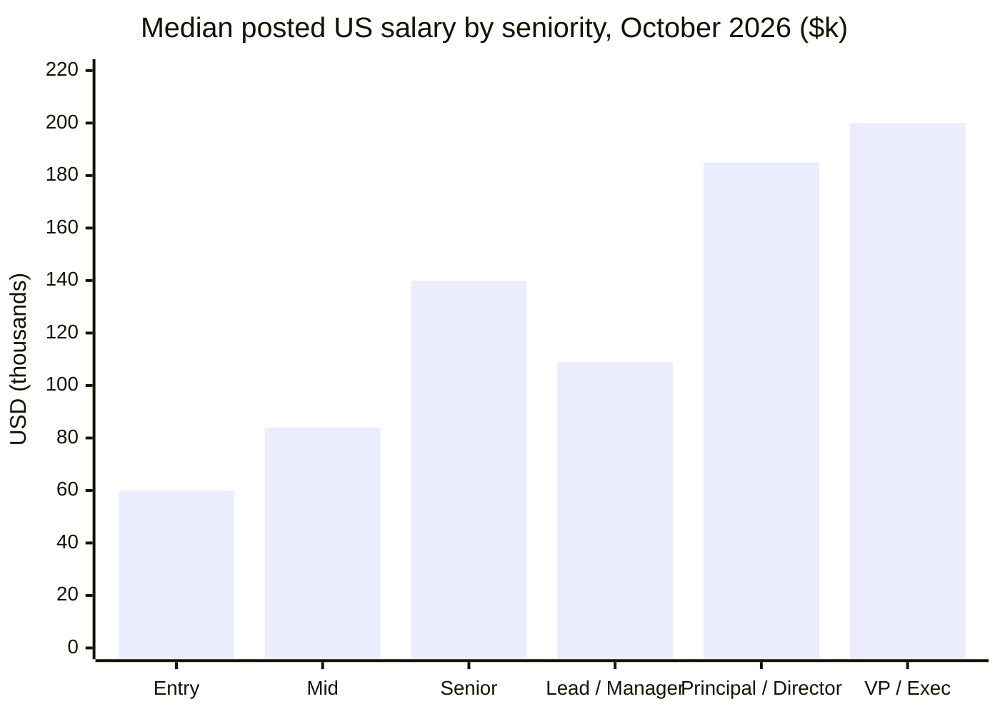

# RiseMe Job Market Stats

**Monthly open data on new job postings in the United States and Canada:** volume by role and metro, posted salaries, remote/hybrid share, pay-transparency compliance, seniority, visa sponsorship language and hiring trends.

Published by [RiseMe](https://riseme.ai), an AI job-matching platform that tracks postings directly from employer applicant tracking systems (Greenhouse, Lever, Ashby, SmartRecruiters, Workable) and aggregated ATS feeds.

| Latest report | Postings analysed | Employers | Last updated |
|---|---|---|---|
| [October 2026](data/2026-10/) | 175,838 | 24,926 | 2026-11-01 |

---

## October 2026 at a glance

- **175,838 new job postings** from **24,926 employers**: 158,616 in the US, 10,994 in Canada and 6,228 remote roles that state no country.
- **15.6% remote, 15.9% hybrid, 68.4% on-site.** Remote work is concentrated in a few roles. Nearly half of senior data scientist postings are remote (48.7%) versus 6.5% of registered nurse postings.
- **55.3% of US postings state a salary.** The median posted US salary is **$100,000** (middle half: $60k–$154k), and 26.7% of postings with a salary pay $150k or more.
- **Pay-transparency laws work.** In jurisdictions that require a pay range in the job ad, **70.6%** of postings include one, versus **41.3%** everywhere else.
- **AI and machine learning roles are 4.2% of all postings** (7,389) and pay a median of **$179,000**.
- **Hiring was flat month over month, but not broadly.** Among 604 employers tracked continuously since July, new postings per weekday were unchanged from September (0.0%). But **282 employers posted less and 256 posted more**: healthcare and a handful of hiring waves offset declines in engineering (−15.4%), product (−22.8%) and AI/ML roles (−14.5%).

---

## Key findings

### 1. Pay-range laws decide whether you see a salary

Every jurisdiction with a posting pay-range law sits between **65% and 81%** disclosure. Of the regions without one, only four clear 50%. The rest sit between **27% and 43%**.

| Region | Pay-range law in job ads | Postings with salary |
|---|---|---|
| Washington | Yes | 81.4% |
| Colorado | Yes | 76.6% |
| Minnesota | Yes | 75.7% |
| Massachusetts | Yes | 73.2% |
| California | Yes | 69.9% |
| New York | Yes | 68.4% |
| Ontario | Yes | 67.6% |
| Illinois | Yes | 65.0% |
| Texas | No | 37.1% |
| Florida | No | 37.8% |
| Michigan | No | 33.7% |
| Quebec | No | 27.9% |
| Louisiana | No | 27.4% |

The four exceptions are Virginia (69.6%), Connecticut (63.8%), Oregon (59.5%) and Maine (59.3%). Full table, 47 states and provinces: [`salary-transparency-by-region.csv`](data/2026-10/salary-transparency-by-region.csv).

### 2. The highest-paying roles (US median posted salary)

| Role | Median | Middle 50% | Remote |
|---|---|---|---|
| [Staff software engineer](https://riseme.ai/jobs/staff-software-engineer-jobs) | $214,000 | $175k–$252k | 26.2% |
| [Engineering manager](https://riseme.ai/jobs/engineering-manager-jobs) | $214,000 | $174k–$252k | 24.6% |
| [Senior software engineer](https://riseme.ai/jobs/senior-software-engineer-jobs) | $203,000 | $170k–$230k | 32.6% |
| [Machine learning engineer](https://riseme.ai/jobs/machine-learning-engineer-jobs) | $201,000 | $165k–$245k | 29.5% |
| [Technical program manager](https://riseme.ai/jobs/technical-program-manager-jobs) | $190,000 | $163k–$223k | 16.6% |
| [Senior product manager](https://riseme.ai/jobs/senior-product-manager-jobs) | $190,000 | $170k–$220k | 39.2% |
| [Senior data scientist](https://riseme.ai/jobs/senior-data-scientist-jobs) | $188,000 | $160k–$205k | 48.7% |
| [AI engineer](https://riseme.ai/jobs/ai-engineer-jobs) | $183,000 | $145k–$221k | 26.7% |

All 39 roles, with remote share, salary spread and top metros: [`roles.csv`](data/2026-10/roles.csv).

### 3. Pay by seniority

"Lead / Manager" pays less than "Senior" because the band includes frontline managers in retail, hospitality and field operations, not only engineering and product leads. See [`seniority.csv`](data/2026-10/seniority.csv).

### 4. Where the jobs are (on-site and hybrid postings)

| Metro | Postings | Median salary | Salary posted | Hybrid |
|---|---|---|---|---|
| [San Francisco Bay Area](https://riseme.ai/jobs/in/sf-bay-area) | 10,164 | $168,000 | 63.4% | 30.6% |
| [New York City](https://riseme.ai/jobs/in/nyc) | 7,971 | $116,000 | 66.8% | 30.8% |
| [Los Angeles](https://riseme.ai/jobs/in/la) | 6,617 | $108,000 | 74.3% | 16.5% |
| [Washington D.C.](https://riseme.ai/jobs/in/dc) | 4,802 | $127,000 | 71.2% | 25.9% |
| [Dallas-Fort Worth](https://riseme.ai/jobs/in/dallas) | 4,007 | $91,000 | 39.1% | 15.9% |
| [Chicago](https://riseme.ai/jobs/in/chicago) | 3,683 | $98,000 | 67.5% | 28.0% |
| [Boston](https://riseme.ai/jobs/in/boston) | 3,493 | $121,000 | 75.5% | 25.4% |
| [Austin](https://riseme.ai/jobs/in/austin) | 3,020 | $107,000 | 41.1% | 18.6% |
| [Toronto](https://riseme.ai/jobs/in/toronto) | 2,991 | CA$98,000 | 63.3% | 43.4% |
| [Seattle](https://riseme.ai/jobs/in/seattle) | 2,888 | $120,000 | 81.6% | 24.2% |

Toronto has the highest hybrid share of any large metro, at 43.4%. All 20 metros: [`metros.csv`](data/2026-10/metros.csv).

### 5. Visa sponsorship: far more postings rule it out than offer it

Among US engineering postings, **23.9% explicitly say the employer will not sponsor a visa**, while only **1.3% explicitly say it will**. Most postings say nothing either way. The ratio is similar for product (13.5% vs 1.0%) and finance (13.3% vs 0.7%). See `us_visa_sponsorship_stated_pct` and `us_no_sponsorship_stated_pct` in [`role-families.csv`](data/2026-10/role-families.csv).

### 6. Month-over-month trend (like-for-like panel)

New postings per weekday among 604 employers tracked continuously since July:

| Month | Postings per weekday | AI/ML share | Remote | Salary posted |
|---|---|---|---|---|
| Jul 2026 | 551 | 10.1% | 35.4% | 56.7% |
| Aug 2026 | 604 | 9.6% | 31.3% | 54.5% |
| Sep 2026 | 592 | 10.6% | 31.4% | 56.8% |
| Oct 2026 | 592 | 9.0% | 30.1% | 58.7% |

Remote share in this panel fell 5.3 points over four months. Per-role and per-family changes are the `panel_mom_pct` columns in [`roles.csv`](data/2026-10/roles.csv) and [`role-families.csv`](data/2026-10/role-families.csv). This panel leans toward tech employers, because those are the companies that use Greenhouse and Lever. Read it as a tech-sector trend, not a whole-economy one.

---

## Files

Each month lives in `data/YYYY-MM/` and is never edited after publication, so citations stay stable. [`data/latest/`](data/latest/) always mirrors the newest month.

| File | What it contains |
|---|---|
| `summary.json` | Headline numbers, scope and exclusion counts |
| `roles.csv` | 39 roles: postings, remote/hybrid/on-site share, US salary quartiles, share paying $150k+, top metros, month-over-month change |
| `role-families.csv` | Broad job families: seniority mix, people-management share, salary, visa sponsorship language, month-over-month change |
| `metros.csv` | 20 US and Canadian metros: on-site/hybrid postings, hybrid share, salary disclosure, salary quartiles in local currency, top job families |
| `salary-transparency-by-region.csv` | Share of postings with a salary, by US state and Canadian province, with whether a posting pay-range law applies |
| `seniority.csv` | Postings, remote share and US salary quartiles for six seniority bands |
| `top-hiring-companies.csv` | 50 employers with the most new postings in the month |
| `trend-panel.csv` | Four-month like-for-like trend |

Column definitions are in [METHODOLOGY.md](METHODOLOGY.md#column-reference).

## Methodology in brief

- **What counts as a posting:** a job first published during the month. A republished older job is not counted, and neither is the same opening syndicated by several sources (each is counted once).
- **Excluded:** staffing agencies, job aggregators and roles located outside the US and Canada.
- **Salary:** employer-stated pay ranges only, from structured posting data. Estimates and inferred salaries are never used. Hourly, weekly and monthly pay is annualised, and implausible values are dropped. Medians and shares are withheld when based on fewer than 50 salaries or 100 postings.
- **Trend:** reported only for a fixed panel of employers whose job boards were tracked continuously across the whole window, so a change in coverage can't masquerade as a change in hiring.
- **Coverage:** this is a large sample of employer-posted jobs, not a census. Employers that hire mainly through channels we don't track are under-represented.

Full details: [METHODOLOGY.md](METHODOLOGY.md).

## How to cite

> RiseMe Job Market Stats, October 2026. RiseMe (riseme.ai). https://github.com/RiseMe/RiseMe-stats

Use GitHub's **"Cite this repository"** button for BibTeX and APA. When quoting a single figure, please link to [riseme.ai](https://riseme.ai) or to this repository.

## License

Data and text are licensed under [Creative Commons Attribution 4.0 International (CC BY 4.0)](LICENSE). You may share, adapt and use them commercially as long as you credit **RiseMe (riseme.ai)**.

## Questions, corrections and custom cuts

Open an [issue](https://github.com/RiseMe/RiseMe-stats/issues) for corrections or requests. Journalists and researchers who need a role, metro or company breakdown not listed here can ask through an issue as well.

Looking for these jobs rather than the statistics? Browse live postings by [role](https://riseme.ai/jobs), [metro](https://riseme.ai/jobs/in/nyc) or [remote](https://riseme.ai/jobs/remote) on RiseMe.
